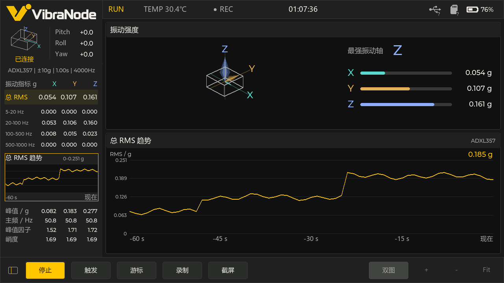

# VibraScope for M5Stack Tab5

VibraScope 是运行在 M5Stack Tab5（ESP32-P4）上的振动分析终端。配套的 VibraNode 探头通过 USB CDC 传输 ADXL357 加速度和 ICM42688 加速度、角速度及姿态数据。桌面模拟器可用演示数据运行同一套界面和分析流程。



## 功能

- 时域波形、FFT、瀑布图和 RMS 趋势，支持 XYZ 与合成矢量、频段设置和游标。
- 实时姿态与振动强度、传感器量程和统计窗、六面标定及静态陀螺零偏校准。
- SD 卡原始录制、截图、配置保存和 USB 磁盘导出。
- 支持 TAB5 键盘扩展及快捷键。主界面点击「开始」后启动采集。

## TAB5 固件

使用 **ESP-IDF 5.4.4**。先进入已激活 ESP-IDF 的终端，从仓库根目录运行：

```powershell
cd platforms/tab5
idf.py --no-ccache -D IDF_TARGET=esp32p4 reconfigure
cmake --build build --parallel 2
idf.py -p COM10 -b 460800 flash monitor
```

将 `COM10` 换成设备的 USB Serial/JTAG 端口。固件在 `platforms/tab5/build/vibranode_tab5.bin`。如果有串口日志工具正在运行，先释放该端口。编译内存充足时也可用 `idf.py build`。锁定的组件版本和默认配置随仓库提供，首次配置时 ESP-IDF 会下载缺失的托管组件。

把探头接到 TAB5 的 USB 主机端口。USB Serial/JTAG 口用于烧录和日志，设备设置里的「连接电脑」会暂时把这条连接切换为 SD 卡磁盘导出。

## Windows 模拟器与宿主机测试

Windows 模拟器需要 Visual Studio C++ 工具链、CMake、Ninja 和 SDL2 VC 开发包。脚本默认指向开发机路径，可通过 `-SdlRoot`、`-CMakePath`、`-NinjaPath` 和 `-VsDevCmd` 指定自己的安装位置。

```powershell
.\tools\build-desktop-windows.ps1 -Run
```

在有 C++17 编译器的开发终端运行宿主机回归：

```powershell
cmake -S tests/host -B tests/host/build-host -G Ninja -DCMAKE_BUILD_TYPE=Release
cmake --build tests/host/build-host --parallel 2
ctest --test-dir tests/host/build-host --output-on-failure
```

## 录制数据

新录制保存在 SD 卡的 `RECORDS/`，截图保存在 `SCREENS/`。在「设备设置 → 连接电脑」中打开 USB 磁盘导出，复制文件后先在电脑上安全弹出磁盘。也可以取出 SD 卡读取。

```powershell
python tools/inspect-vnr.py VN000001.VNR --csv VN000001.csv
```

解析器兼容 VNR v1–v3。CSV 的 `stream=1` 是 ADXL357，`stream=2` 是 ICM42688。加速度单位为 g，角速度单位为 °/s。详见 [VNR 格式与应用说明](app/apps/app_vibescope/README.md#原始录制)。

`tools/tab5-vnr-usb.py` 是依赖 VNUSB 串口协议的实验客户端。当前固件的数据导出入口是 USB 磁盘。

## 代码布局

| 路径 | 内容 |
| --- | --- |
| `app/apps/app_vibescope/` | 采集会话、分析、录制和 LVGL 界面 |
| `components/` | 探头帧协议、客户端与公共测量类型 |
| `platforms/tab5/` | ESP32-P4 板级代码、分区表和默认配置 |
| `platforms/desktop/` | SDL2 模拟器 |
| `tests/host/` | 宿主机回归测试 |

构建所需的 UI 素材和字体已随源码提供。项目源自 M5Stack Tab5 User Demo。许可和依赖来源见 [LICENSE](LICENSE) 与 [THIRD_PARTY.md](THIRD_PARTY.md)。

## 许可

自研软件采用 PolyForm Noncommercial 1.0.0，商业使用需单独授权。适用范围及第三方许可见 [LICENSING.md](LICENSING.md)。
